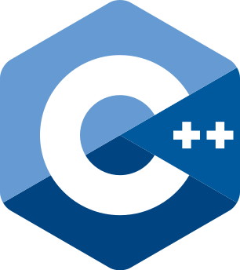

## Hi there 👋 This is Waleed!

 I am a C++ Developer at SAP!

## 📫 How to reach me:

 [waleed.binkhalid@hotmail.com](mailto:waleed.binkhalid@hotmail.com) 

[LinkedIn](https://www.linkedin.com/in/waleedbk/) 

## :nerd_face: Languages and tools that I use

 C++

 Python

 Git

 JavaScript / TypeScript

 Rust

## :hammer_and_wrench: Current and Previous Projects
:bank: SAP HANA JSON DocStore Engine: The NoSQL offer from SAP HANA  

:floppy_disk: [BSON-SQL-JSON](https://github.com/waleedbinkhalid74/bson-sql-json): A C++ library that offers SQL Standard functions on BSON   

:moneybag: Stock Tracker: Personal help full-stack app to track my stocks.    

:money_with_wings: [Debt settler](https://waleedbinkhalid74.github.io/debt_settler/): Find the simplest way to settle debts in groups.  

:heavy_division_sign: Master Thesis: Kernel Flows on Neural Network Induced Gaussian Process Kernels.  

:walking: Crowd Modeller: Software that models crowd movements based on the cellular automata approach 

:b: Wordle Solver: Algorithm to solve the Wordle Puzzle in minimum number of steps 

:moneybag: Crypto-Notificator: Telegram bot to automatically update on key stats for Crypto Assets 

:vertical_traffic_light: Map Convertor: Convertor to transform openDrive format to commonroad format (.xml) Info: [commonroad](https://commonroad.in.tum.de/) 

### :gear: Some of the projects I have worked on recently that are not subjected to copyrights are provided below. Other projects not listed below can be discussed as well :smile: 
